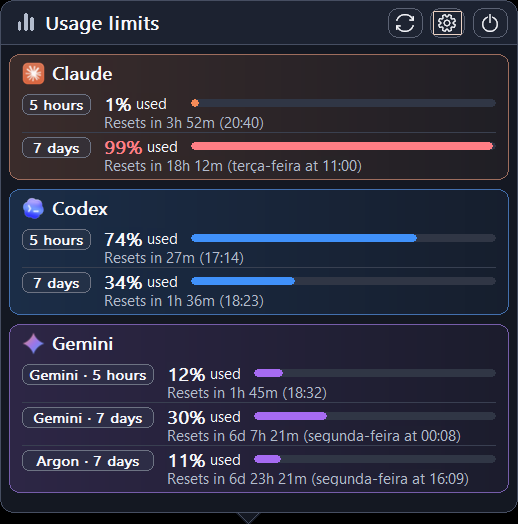
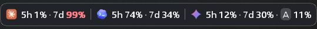
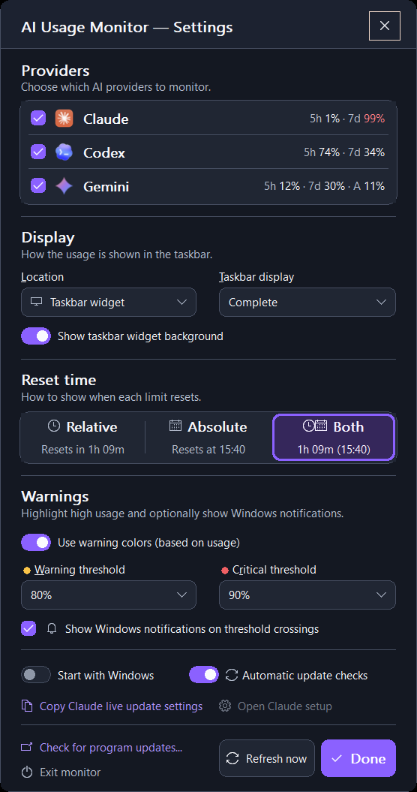

# AI Usage Monitor

AI Usage Monitor displays the percentage of the **5-hour** and **7-day** subscription limits used by Claude Code, Codex and Google Antigravity in the Windows taskbar. Gemini 4 Argon has its own weekly indicator when the account reports a separate quota.



**AI Usage Monitor uses zero model tokens.** It reads quota metadata using the installed CLIs and receives updates from your existing sessions. It sends no model prompts and adds no token usage when it refreshes.

## Install

Download and run the latest `AIUsageMonitor-Setup` installer on Windows 10 or 11 with x64 support. Sign in to the CLI for each provider you use. [Latest release](https://github.com/p-freitas/AI-Usage-Monitor/releases/latest)

**Linux:** The maintainer has never used or tested AI Usage Monitor on Linux. The distributed installer targets Windows. Pull requests are welcome, including contributions toward Linux support.

Select **Enable Claude Code live updates** during installation for reliable Claude readings. If you skip it, the installer asks you to confirm that readings may be delayed or unavailable.

Selecting this option configures the `statusLine` entry in `%USERPROFILE%\.claude\settings.json` or the directory set by `CLAUDE_CONFIG_DIR`. Setup also authorizes the monitor's dedicated empty folder (`%LOCALAPPDATA%\AIUsageMonitor\ClaudeCode`) for background quota checks when the standard Claude Code profile is available. This approval applies only to that folder. If Claude Code needs interactive setup, such as first-time sign-in or consent under a custom profile, the installer opens Claude Code so you can finish it. [Claude Code workspace trust documentation](https://code.claude.com/docs/en/errors#workspace-has-not-been-trusted)

A status line generated by Wireless Battery is extended to send updates to both applications. Setup preserves unrelated custom commands. When possible, uninstall restores the status-line and workspace trust entries the installer changed.

### Existing custom Claude status line

Keep your current status-line renderer and forward the same JSON to this monitor. In a PowerShell status-line script, for example:

```powershell
$payload = $input | Out-String
$payload | & "$env:LOCALAPPDATA/Programs/AI Usage Monitor/AIUsageMonitor.exe" --claude-statusline | Out-Null
$payload | & 'C:/path/to/existing-statusline.exe'
```

Use your own install path if you chose a different folder. **Copy Claude live update settings** in Settings also provides the complete entry for setups without an existing status line.

## How updates work

- Codex reads account limits at startup and watches local session events for live updates. When available, the last unexpired local reading appears dimmed until a new reading arrives. Install either Codex CLI or Codex Desktop and sign in.
- Claude Code live updates use the status-line payload from your trusted projects. Background polling uses the built-in `/usage` command. If you install Claude Code later, choose **Open Claude setup** in Settings, complete the setup shown there and choose **Refresh now**.
- Gemini reads the installed Antigravity CLI's structured quota report. The monitor checks the executable with `--version` before its first query and again when the executable changes. The verified Windows version is **1.5.15**. Other versions are shown in Settings as unverified and receive no quota command. A successful report identifies the built-in usage command and reports zero agent turns and zero tokens. Gemini usage is calculated from each reported remaining fraction. The separate Antigravity Claude/GPT group is ignored. [Official CLI changelog](https://github.com/google-antigravity/antigravity-cli/blob/main/CHANGELOG.md)
- Enabled providers use the existing two-minute refresh interval to pick up changes from other devices. The monitor also offers notification-area icons for taskbars that cannot host the widget.



### CLI status in Settings

Settings lists all three providers even before any usage is available. It tells you whether to install the CLI (or Codex Desktop), sign in, finish Claude Code setup, or wait for the first reading. If a quota check fails, choose **Refresh now** to retry. If you install Antigravity CLI while the monitor is running, sign in through the CLI and choose **Refresh now**. Providers without readings occupy no space in the widget.

### Display and warnings

Click the widget or a notification-area icon to open the usage panel. It stays open as you move the pointer and closes when you click outside it. The header has buttons to refresh quotas, open Settings over the panel or exit the monitor. Use the provider checkboxes to show or hide each provider. **Taskbar display** selects Complete, Minimal or Weekly only. Gemini uses **A** for the independent Argon weekly quota. A limit missing from the Antigravity report has no indicator. If the widget cannot fit between the taskbar edge and its neighbors, the monitor falls back to tray icons.



Hover over the widget to see each quota with its percentage, progress bar and local reset time. **Reset time format** offers Relative (default), Absolute or Both. A dimmed value marked **Last known** comes from a cached reading or an account check that could not refresh it. When a known reset passes, that reading expires until the next update. The tray uses the standard Windows text tooltip.

**Warnings** lets you select the amber and red thresholds (defaults 80% and 90%), switch warning colors off, or enable Windows notifications. An exhausted limit also shows **100%!**. Notifications start disabled and use the first fresh reading as their baseline. Preferences take effect immediately and persist for the current Windows user.

## Program updates

Official Windows builds check GitHub for a newer stable release shortly after startup and then about once a day. Settings shows an available version and offers **Check for program updates** and **Automatically check for program updates**. Select **Download and install** to approve installation. The monitor verifies the publisher's release signature and the installer's SHA-256 before running it. An in-place update keeps the current settings and reopens the monitor.

The signature used by the updater is separate from the Authenticode publisher signature shown by Windows. GitHub Actions builds and tests the installer and prepares a draft release. See the [release and signing guide](docs/releasing.md).

## Use alongside BatteryHub

AI Usage Monitor and BatteryHub (formerly Wireless Device Battery Monitor) can run side by side on the Windows taskbar. When both widgets are visible, AI Usage Monitor displays provider usage next to BatteryHub's device battery levels. Both apps have their own settings, tray icons and startup entries. [BatteryHub by krisgfx9](https://github.com/krisgfx9/Wireless-Device-Battery-Monitor)


## Memory and CPU

AI Usage Monitor is a native C++/Win32 app. In a four-minute Windows 10 test, v1.0.1 used **about 2.9 MiB of private RAM at idle**. Its total working set was about 17 MiB, including shared Windows pages. The monitor process averaged about 0.5% of one logical CPU during the test.

In v1.0.2, the classic Windows taskbar uses its existing native window lookup for the weather widget. A controlled test with both usage indicators showed **about 0.8 MiB less private RAM** after removing the redundant UI Automation lookup. BatteryHub, the project that inspired this widget, reports about 2 MB of RAM for its own app. [BatteryHub README](https://github.com/krisgfx9/Wireless-Device-Battery-Monitor#readme)

The monitor starts the installed CLIs briefly for account-wide checks. In the same Windows 10 test, the Claude Code subprocess reached about 200 MiB of private RAM during a check and exited a few seconds later. Those short-lived processes are measured separately from the monitor's idle footprint.

The detailed hover card uses one Win32 popup with GDI drawing. The click panel uses the same drawing code. The window, fonts and minute timer exist only while the card is open. Opening it reads the monitor's in-memory snapshot and never starts a CLI process. The standard notification-area tooltip remains shell-managed.

## Build

Install MinGW-w64 with `g++` and `windres` and put them and GNU Make on PATH. Run `make` to build `AIUsageMonitor.exe` and `make test` to run the tests. With Inno Setup installed, run this from the repository root to create the installer in `dist`:

```powershell
ISCC.exe installer\AIUsageMonitor.iss
```

## Credits and license

AI Usage Monitor is directly inspired by BatteryHub and adapts its Windows taskbar widget. See [credits](CREDITS.md) and the [GPL-3.0 license](LICENSE) for the terms for using, changing and sharing this project.
